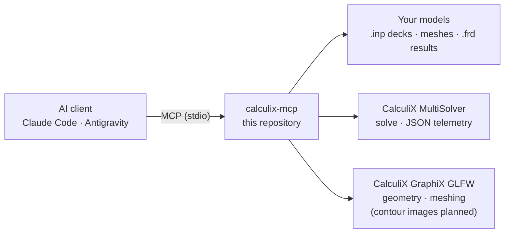

# calculix-mcp

[](https://github.com/carlomontec/calculix-mcp-rs/actions/workflows/ci.yml)
[](https://www.rust-lang.org/)
[](https://modelcontextprotocol.io/)
[](http://www.calculix.de/)
[](LICENSE)

**Let an AI agent work on real CalculiX models.** `calculix-mcp` is a Model Context Protocol server that gives Claude, Antigravity or any MCP client direct access to your finite-element work: it builds geometry and meshes through CalculiX GraphiX, reads decks with their whole `*INCLUDE` tree and edits them into new files, checks the mesh, selects faces and finds contact pairs, runs the solver in the background, explains convergence problems, and quotes exact results with node ids from ASCII or binary `.frd` files.

It is written in Rust, works on the decks and result files you already have, and never asks the model to estimate a number it can compute. The repository also includes [`cgx-top`](#cgx-top-results-in-your-terminal), a small terminal tool for checking results by hand.



## Part of a CalculiX toolchain

`calculix-mcp` is one of three projects that together give CalculiX a modern, scriptable workflow:

| Project | Role |
|---|---|
| **calculix-mcp-rs** (this repository) | The MCP server and the Rust library behind it: deck inspection, mesh checks and face selection, solver jobs, convergence diagnosis, result queries |
| [**CalculiX MultiSolver**](https://github.com/carlomontec/CalculiX-CrunchiX-MultiSolver) | A multi-platform edition of the CalculiX solver (CrunchiX) with selectable sparse solvers (MUMPS, Apple Accelerate, PARDISO, SPOOLES) and JSON run telemetry, which `calculix-mcp` reads to report each solve |
| [**CalculiX GraphiX GLFW**](https://github.com/carlomontec/CalculiX-GraphiX-GLFW) | A multi-platform edition of the CalculiX pre- and post-processor (GraphiX) on GLFW, whose batch mode `calculix-mcp` runs to build geometry and meshes, and whose command channel will let it render contour plots |

## What a session looks like

Condensed from a real Claude Code session on the 7-sector compressor rotor benchmark (a 74,000-line deck and a 409 MB result file). The numbers are the server's output.

> **You:** Is the rotor deck sound, and what did the last run give?
>
> **Agent** calls `inp_inspect`, `mesh_check` and `frd_summary`, then answers:
>
> The deck is a cyclic-symmetry model (`*CYCLIC SYMMETRY MODEL, N=7`) in 5 files with no missing includes: a static preload step at line 47, then a perturbation frequency step at line 57.
> The mesh is one connected part of 10,816 C3D20R elements with no free nodes and no inverted elements; volume 8,130.8 and mass 2.15e-5 in deck units. The worst aspect ratio is 26.7, at elements 7888 and 7904.
> The result file holds the full 342,139-node expansion. Modes 1, 3 and 5 at nodal diameter 5 are at 8,310, 11,052 and 15,321. Their stress peaks are normalised mode-shape amplitudes, not physical stresses.

More examples, with the raw tool output, are in the [server README](crates/calculix-mcp/README.md); a plain-language guide to every tool is in [docs/TOOLS.md](docs/TOOLS.md).

## Highlights

- Works on existing decks: the whole `*INCLUDE` tree, cyclic symmetry, modal results with mode number and nodal diameter.
- Reads large ASCII and binary `.frd` files lazily; a 409 MB file is summarised in 0.6 s.
- Builds geometry and meshes through CalculiX GraphiX, finds contact pairs, and edits decks only by writing new files.
- Solves on a private copy of the deck in the background and always cleans up its processes.
- Confined to the models folder, no shell, and returns exact values with node ids instead of estimates.

`calculix-mcp` runs with stock CalculiX. With [CalculiX MultiSolver](https://github.com/carlomontec/CalculiX-CrunchiX-MultiSolver) it also gets a JSON report of every run (per-step convergence, solver, timings, mode tables), so job status and diagnosis are richer.

## Install and connect

```bash
git clone https://github.com/carlomontec/calculix-mcp-rs.git
cd calculix-mcp-rs
cargo build --release -p calculix-mcp
```

Register the server with your client. For Claude Code:

```bash
claude mcp add --scope user calculix -- /abs/path/to/calculix-mcp --ccx mumps=/abs/path/to/CalculiX
```

or share it with a project in `.mcp.json`:

```json
{
  "mcpServers": {
    "calculix": {
      "type": "stdio",
      "command": "/abs/path/to/calculix-mcp",
      "args": ["--ccx", "mumps=/abs/path/to/CalculiX"]
    }
  }
}
```

The same block works for Antigravity (`~/.gemini/config/mcp_config.json`), VS Code with GitHub Copilot (`.mcp.json` or `~/.copilot/mcp-config.json`) and Claude Desktop. Add `--cgx PATH` to enable geometry and meshing. The models folder follows the folder you open, or you can tell the assistant where your models are.

Then ask in plain language:

```text
Check the mesh of run/bracket.inp before I solve it.
Solve run/bracket.inp with mumps and tell me when it is done.
What is the peak von Mises stress on set FILLET, and at which nodes?
```

All flags, client setups, platform notes, the safety model and limitations are in the [server README](crates/calculix-mcp/README.md).

## Tools

| Stage | Tools |
|---|---|
| Setup | `models_folder` |
| Decks | `inp_inspect`, `inp_cards`, `inp_consolidate`, `inp_edit` |
| Geometry | `cgx_run_batch`, `cgx_help` |
| Mesh | `mesh_check`, `mesh_select`, `mesh_contact_pairs` |
| Solve | `ccx_solve`, `ccx_job_status`, `ccx_job_cancel`, `ccx_job_list`, `ccx_diagnose` |
| Results | `frd_summary`, `frd_sets`, `frd_query_set` |

What each tool does, with an example prompt and a real result: [docs/TOOLS.md](docs/TOOLS.md).

## cgx-top: results in your terminal

`cgx-top` is a small terminal tool on the same Rust library: no AI client, nothing to configure, works over SSH.

```bash
cargo build --release -p cgx-top

cgx-top results.frd                                 # interactive dashboard
cgx-top --summary results.frd                       # steps, fields, sets and extrema
cgx-top results.frd deck.inp -S BLADE_ROOT --mises  # von Mises history on a set (--principal, --disp, --csv)
cgx-top check deck.inp                              # include tree, sets, materials
cgx-top diagnose run/job                            # convergence verdict from .sta and .cvg
```

The dashboard on a modal beam with step 3 selected (a capture of the real screen):

```text
╭────────────────────────────────────────────────────────────────────────────────────────────────────────────────────╮
│ cgx-top │ beam_modal.frd (237.19 KB) │ Nodes: 261 Elements: 32 Steps: 5 │ Set: [[ALL NODES]] (261 nodes (all))     │
╰────────────────────────────────────────────────────────────────────────────────────────────────────────────────────╯
╭ Steps / Modes / Loads (5) [W/S, 1-9╮╭ Step Extrema & Invariant Details [Tab: All Fields] ──────────────────────────╮
│  Step 1   (t=1.310e4) DISP         ││Step 3 │ Incr 1 │ Value: 7.693814e4 │ DISP │ Set: [[ALL NODES]] (261 nodes)  ◄│
│  Step 2   (t=1.310e4) DISP         ││A/D cycle (0=ALL) ►                                                           │
│▶ Step 3   (t=7.694e4) DISP         ││──────────────────────────────────────────────────────────────────────────────│
│  Step 4   (t=7.694e4) DISP         ││● NODAL DISPLACEMENT (Field: DISP)                                            │
│  Step 5   (t=9.357e4) DISP         ││   Peak Magnitude (ALL): 8.066241e3 at Node #8  (Min: 0.0000e0)               │
│                                    ││   D1    min: -5.5923e3    (Node #173  )  │  max: 7.5018e3     (Node #25)     │
│                                    ││   D2    min: -1.4282e3    (Node #7    )  │  max: 1.1808e3     (Node #55)     │
│                                    ││   D3    min: -2.6019e3    (Node #6    )  │  max: 2.6019e3     (Node #8)      │
│                                    ││   ALL   min: 0.0000e0     (Node #94   )  │  max: 8.0662e3     (Node #8)      │
│                                    ││                                                                              │
│                                    ││● CAUCHY STRESS & INVARIANTS (Field: STRESS)                                  │
│                                    ││   von Mises: 2.214251e8 at Node #2                                           │
│                                    ││   S1 (Max Principal): 3.6240e8     (#2)  │  S3 (Min Principal): -3.6240e8    │
│                                    ││(#4)                                                                          │
╰────────────────────────────────────╯╰──────────────────────────────────────────────────────────────────────────────╯
╭ Peak von Mises Stress History across Steps [Filter: [ALL NODES]] ──────────────────────────────────────────────────╮
│    3.25e8 ┤                                                                                               ╭─────   │
│           │                                                                                    ╭──────────╯        │
│           │                                                 ╭──────────────────────────────────╯                   │
│    1.86e8 ┤                                           ╭─────╯                                                      │
│           │                                    ╭──────╯                                                            │
│           │                              ╭─────╯                                                                   │
│    4.67e7 ┤ ─────────────────────────────╯                                                                         │
│           └─────────────────────────────────────────────────────────────────────────────────────────────────────   │
╰────────────────────────────────────────────────────────────────────────────────────────────────────────────────────╯
 [W/S] Step   [A/D] Rotate Set   [0] All Nodes   [1-9] Jump Step   [Space] Set List   [Tab] Field   [?] Help   [q/Esc]
```

Press `?` in the dashboard for the key bindings.

## Roadmap

- [ ] Contour images rendered by CalculiX GraphiX
- [ ] `cgx-top --watch`: live view of a running solve
- [ ] Windows process-tree handling for cancelled solves

## Contributing

Bug reports, decks that break a tool, and pull requests are welcome. See [CONTRIBUTING.md](CONTRIBUTING.md) for building, testing and style, and [SECURITY.md](SECURITY.md) for reporting vulnerabilities privately. Changes are listed in the [changelog](CHANGELOG.md).

## License

Copyright (C) 2026 Carlo Daniel Monjaraz Tec.

Licensed under the [GNU Affero General Public License v3.0](LICENSE) or later. You may use, modify and sell this software. If you distribute it, or let people use a modified version over a network, you must make the complete source available under the same license and keep the copyright notices.
